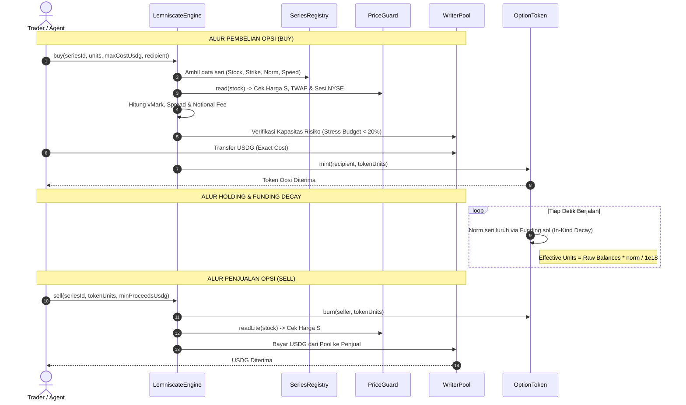

# ARCUM PROTOCOL — SMART CONTRACTS REFERENCE & ARCHITECTURE OVERVIEW
> **Dokumen Orientasi & Bedah Kode Teknis Tim Developer Arcum**  
> **Status:** Ekstraksi Terverifikasi dari Sourcify (Robinhood Chain ID: `4663`)  
> **Lokasi Relatif Source Code:** `contracts/src/` (Total: 44 file modul protokol + 43 file OpenZeppelin)  
> **Baseline Referensi Upstream:** Lemniscate Protocol (`1d434a3a3186cbb0feed172dec3a872cfa610e09`)

---

## 1. Orientasi & Pesan untuk Tim Dev Arcum

Halo tim dev,

Dokumen ini adalah **panduan bedah kode resmi (code-by-code reference)** untuk seluruh smart contract yang ada di folder `contracts/src/`.

### Mengapa Kode Ini Ada di Sini?
Repositori GitHub upstream (`lemniscatedev/lemniscate`) saat ini telah di-private dan situs referensi mereka berstatus non-aktif. Namun, karena protokol ini sudah dideploy dan berjalan di **Robinhood Chain Mainnet (Chain ID `4663`)**, seluruh kode sumber Solidity aslinya telah diverifikasi *byte-for-byte* (*Exact Match*) di **Sourcify**. 

Kita telah mengekstrak 100% kode sumber tersebut ke repository lokal kita sebagai **Cetak Biru (Blueprint)**.

### Apa yang Harus Dilakukan Tim Dev?
1. **JANGAN membuat kontrak dari nol.** Seluruh matematika opsi everlasting, proteksi reentrancy via transient storage, integrasi EIP-712, dan pool accounting sudah diuji dan berjalan di mainnet.
2. **KONTRAK INI ADALAH REFERENSI LOGIKA.** Kita **BUKAN** menghubungkan aplikasi kita ke address Lemniscate. Tugas tim dev adalah:
   * Melakukan sanitasi brand/namespace (`Lemniscate` $\rightarrow$ `Arcum`).
   * Melakukan kompilasi via Foundry (`forge build` dengan target Solidity `0.8.28` dan EVM `cancun`).
   * Menyiapkan script deployment untuk mendeploy instance **Arcum kita sendiri** di Robinhood Chain dengan wallet deployer, timelock, dan treasury kita sendiri.

---

## 2. Peta Struktur Direktori `contracts/src/`

```text
contracts/src/
├── LemniscateEngine.sol         # Core Options Engine (UUPS Upgradeable Facade)
├── EngineHelper.sol             # Helper kalkulasi opsi, pricing, fee & quotes
├── WriterPool.sol               # USDG Liquidity Provider Pool (ERC-4626 + Queue)
├── SeriesRegistry.sol           # Registri series Call/Put, Strike, Speed & Epochs
├── OptionToken.sol              # ERC-20 per-series option tokens (EIP-1167 Clones)
├── OptionTokenFactory.sol       # Factory pencetak clone token opsi
├── PriceGuard.sol               # Pengaman harga oracle & filter jam market NYSE
├── VolOracle.sol                # Verifikator signature EIP-712 Volatility off-chain
├── AgentRouter.sol              # Delegated non-custodial trading untuk AI Agents
├── UniswapV3TwapReference.sol   # Cross-check harga spot vs TWAP DEX
│
├── engine/                      # SUB-SISTEM INTERNAL ENGINE (Delegatecalled Libraries)
│   ├── EngineStorage.sol        # Penyimpanan ERC-7201 (Single Storage Namespace)
│   ├── EngineCore.sol           # Inisialisasi, parameter, dan pause management
│   ├── EngineTradeLib.sol       # Logika eksekusi pembelian opsi (Buy) & Shield
│   ├── EngineSellLib.sol        # Logika penjualan opsi (Sell) & Queued Escrow
│   ├── EngineMarkLib.sol        # Valuasi portofolio per name & kalkulasi book value
│   ├── EngineOpsLib.sol         # Accrual batch & perawatan norm berkala
│   └── EngineViewLib.sol        # Query read-only untuk frontend/indexer (Greeks, quotes)
│
├── libs/                        # LIBRARY MATEMATIKA & QUANT FINANCIALS
│   ├── EverlastingMath.sol      # Closed-form everlasting option formula (r=0)
│   ├── EverlastingGreeks.sol    # Delta, Gamma, Vega untuk opsi everlasting
│   ├── Funding.sol              # In-kind funding decay exponential: exp(-r*dt/tau)
│   ├── FixedMath.sol            # 64.64 / WAD fixed-point exponential & logarithm
│   ├── OptionTypes.sol          # Structs & Enums (Speed, SessionKind, Series, Quotes)
│   ├── LemniscateTypes.sol      # Tipe umum permodalan & NAV
│   ├── PoolLayers.sol           # Waterfall akuntansi loss (Reserve, Staking, LP NAV)
│   ├── PoolHedging.sol          # Eksekusi spot hedge di Uniswap V3
│   ├── NyseCalendar.sol         # Logika penentuan hari libur & jam buka bursa NYSE
│   ├── Roles.sol                # Keccak256 hash untuk KEEPER_ROLE & GUARDIAN_ROLE
│   └── TickPrice.sol            # Konversi tick Uniswap V3 ke harga desimal WAD
│
└── interfaces/                  # 16 INTERFACES PROTOKOL RESMI
    ├── IOptionEngine.sol        ├── IPool.sol               ├── ISeriesRegistry.sol
    ├── IOptionToken.sol         ├── IPriceGuard.sol         ├── IPriceReference.sol
    ├── IVolOracle.sol           ├── IAgentRouter.sol        ├── IFeeRouter.sol
    ├── IHedgeAdapter.sol        ├── ILmnsStaking.sol        ├── IMarketHours.sol
    ├── IReserve.sol             ├── IStockToken.sol         ├── IWriterVault.sol
    └── IAggregatorV3.sol
```

---

## 3. Bedah Detail Modul: Code-by-Code Analysis

### Bagian A: Top-Level Protocol Contracts

#### 1. `LemniscateEngine.sol`
* **Peran:** Pintu gerbang utama (facade) protokol perdagangan opsi.
* **Arsitektur:** UUPS Proxy Upgradeable. Untuk mematuhi batasan ukuran bytecode Ethereum (EIP-170, max 24.576 KB), kontrak ini memisahkan logikanya ke dalam library eksternal (`EngineTradeLib`, `EngineSellLib`, `EngineOpsLib`, `EngineMarkLib`, `EngineViewLib`) yang dipanggil via `delegatecall`.
* **Mekanisme Finansial Kunci:**
  * **Zero-Custody Engine:** Engine **tidak pernah menahan USDG**. Saat user membeli opsi, USDG ditarik langsung dari user ke `WriterPool`. Saat user menjual opsi, `WriterPool` membayar USDG langsung ke penjual.
  * **In-kind Accrual:** Setiap kali ada interaksi (buy, sell, shield, token transfer), kontrak otomatis menjalankan `accrue()` pada series tersebut terlebih dahulu agar faktor peluruhan (`norm`) diperbarui.
  * **Transient Storage Caching:** Menggunakan opcode `tstore`/`tload` (EVM Cancun / Solidity 0.8.28) untuk menyimpan hasil bacaan harga saham (`PriceGuard.readLite`) selama transaksi berlangsung guna menghemat gas drastis.
  * **Queued Sell:** Jika pasar saham dalam status `HALTED` atau transfer USDG gagal, token opsi tidak hilang melainkan diescrow ke dalam tiket (`ticketHolds`) yang bisa diisi (`fillQueued`) saat pasar buka kembali atau dibatalkan oleh user.

#### 2. `EngineHelper.sol`
* **Peran:** Library kalkulasi murni (pure maths & pricing helper).
* **Fungsi Kunci:**
  * `price()`: Menghitung harga ask (untuk beli) dan bid (untuk jual). Menambahkan *inventory skew* (jika pool terlalu banyak terpapar pada satu arah) dan *session spread* (spread lebih lebar saat jam pre/post-market).
  * `quote()`: Menghasilkan struct `Quote` lengkap untuk UI (USDG cost, vMark, spread, notional fee 3 bps, holding cost harian, dan titik breakeven).
  * `checkStress()`: Menghitung skenario stress testing portofolio jika harga saham anjlok/melonjak tiba-tiba.

#### 3. `WriterPool.sol`
* **Peran:** Kolam likuiditas USDG (LP Counterparty) bertipe ERC-4626.
* **Mekanisme Finansial Kunci:**
  * **Share Accounting:** Menggunakan share 12-desimal (offset 6-desimal dari USDG 6-desimal) untuk mencegah serangan inflasi share (*virtual shares*).
  * **NAV Calculation:**  
    $$\text{NAV} = \text{USDG Cash} + \text{Spot Hedges} - \text{Engine.bookValue()} + \text{Reserve Share} - \text{Fees Owed}$$
  * **Anti-Arbitrage Queues:**
    * **Deposit Lock 24 Jam:** LP yang baru deposit tidak bisa langsung menarik dana untuk mencegah eksploitasi flash-deposit.
    * **Withdrawal Queue 72 Jam:** Penarikan modal melalui tiket antrean 72 jam, dan dinilai pada NAV saat waktu klaim (*claim time*), bukan saat request.
  * **NAV Guard Band:** Entry LP dinilai pada batas bawah liabilitas, sedangkan exit LP dinilai pada batas atas liabilitas untuk melindungi modal pool.

#### 4. `SeriesRegistry.sol`
* **Peran:** Katalog dan registri seluruh seri opsi yang terdaftar.
* **Mekanisme Finansial Kunci:**
  * **Identitas Seri:** Seri diidentifikasi dari tuple `(stockToken, isCall, strike, speed, epoch)`.
  * **Cloning EIP-1167:** Saat seri baru dibuka, kontrak mendistribusikan ERC-20 clone minimal via `OptionTokenFactory` (contoh: `aNVDA-C-110-W`).
  * **Epoch Relisting:** Ketika faktor normalisasi (`norm`) suatu seri sudah luruh jauh (misalnya setelah 9 hari), keeper akan mengarsipkan seri tersebut dan membuka epoch baru (`.2`). Seri lama tetap bisa di-sell selamanya.

#### 5. `OptionToken.sol` & `OptionTokenFactory.sol`
* **Peran:** Kontrak token ERC-20 yang mewakili kepemilikan opsi.
* **Fungsi Kunci:** Hanya `LemniscateEngine` yang memiliki hak `mint` dan `burn`. Setiap pemanggilan fungsi transfer standar ERC-20 (`_update`) mewajibkan pemanggilan hook `engine.accrue(id)` sebelum saldo berpindah tangan.

#### 6. `PriceGuard.sol`
* **Peran:** Sentinel pengaman harga oracle on-chain.
* **Fungsi Kunci:**
  * Membaca harga agregator Chainlink / Pyth.
  * **Sinkronisasi Jam NYSE:** Mengklasifikasikan waktu saat ini ke dalam: `REGULAR`, `EXTENDED`, `CLOSED`, `HALTED`, atau `UNKNOWN`.
  * **Multiplier Handling:** Menerapkan pembagian/perkalian multiplier saham (misal reverse-split) tepat satu kali.
  * **Circuit Breaker:** Jika ada lonjakan harga instan melebihi batas toleransi (`continuityBps`), perdagangan `buy` otomatis dipause sampai ada konfirmasi ronde oracle berikutnya.

#### 7. `VolOracle.sol`
* **Peran:** Oracle volatilitas tersumpah (*signed volatility oracle*).
* **Fungsi Kunci:**
  * Menerima kiriman volatilitas tahunan ($\sigma$) dari server Python off-chain via tanda tangan EIP-712.
  * Memvalidasi batas perubahan maksimal volatilitas (maksimal bergeser 25% per update, dan dibatasi interval minimal 5 menit).
  * Memuat jendela larangan beli menjelang laporan keuangan perusahaan (*earnings window*).

#### 8. `AgentRouter.sol`
* **Peran:** Router eksekusi non-custodial untuk AI Agents.
* **Fungsi Kunci:**
  * Pemilik akun menetapkan kebijakan: alamat agent, maksimal anggaran USDG per transaksi, total limit belanja, daftar saham yang diizinkan, dan tanggal kadaluwarsa otorisasi.
  * Agent dapat melakukan `buy`, `sell`, atau `shield`, namun **seluruh aset opsi dan hasil penjualan USDG langsung masuk ke wallet pemilik**, bukan ke wallet agent.

---

#### 9. `UniswapV3TwapReference.sol` (KODE SUMBER LENGKAP & ANALISIS)
* **Peran:** Oracle harga referensi TWAP dari pool Uniswap V3 untuk melindungi pool saat melakukan eksekusi hedging spot agar tidak terkena serangan MEV / Sandwich attack.
* **Mekanisme Kode:**
  * Menggunakan `observe()` dari pool Uniswap V3 dengan jendela waktu tetap (`window`, misalnya 1800 detik / 30 menit).
  * Menghitung geometric mean tick: $\text{meanTick} = \frac{\text{tickCumulatives}[1] - \text{tickCumulatives}[0]}{\text{window}}$.
  * Mengonversi tick ke rasio harga $1.0001^{\text{tick}}$ dalam format presisi Q128.128 via binary exponentiation.
  * Mengonversi rasio token mentah (Stock Token 18 desimal vs USDG 6 desimal) ke format standar WAD 1e18 menggunakan faktor skala $10^{30}$ (`RAW_TO_WAD`).
  * Menyediakan `spotPrice()` langsung dari `slot0()` tick pool saat ini untuk mendeteksi apakah harga spot sedang dimanipulasi menjauh dari TWAP dalam blok yang sama.

Berikut adalah kode sumber lengkap dari `UniswapV3TwapReference.sol`:

```solidity
// SPDX-License-Identifier: MIT
pragma solidity 0.8.28;

import {Math} from "@openzeppelin/contracts/utils/math/Math.sol";
import {IPriceReference} from "./interfaces/IPriceReference.sol";

interface IUniswapV3FactoryLike {
    function getPool(address tokenA, address tokenB, uint24 fee) external view returns (address pool);
}

interface IUniswapV3PoolLike {
    function token0() external view returns (address);

    function observe(uint32[] calldata secondsAgos)
        external
        view
        returns (int56[] memory tickCumulatives, uint160[] memory secondsPerLiquidityCumulativeX128s);
}

/// @title UniswapV3TwapReference
/// @notice Time-weighted average price of a stock/USDG Uniswap v3 pool over a fixed window. One transaction cannot
/// move it, so a hedge sale floored at it cannot be sandwiched for more than the vault's slippage allowance.
/// @dev Returns zero (no reference) when the pool is missing or cannot serve the window, for example while its
/// observation cardinality is still 1. Stateless; redeploy to change the window.
contract UniswapV3TwapReference is IPriceReference {
    /// @dev 18-decimal stock and 6-decimal USDG: WAD USD per whole token = raw (USDG wei per stock wei) * 1e30.
    uint256 private constant RAW_TO_WAD = 1e30;
    uint256 private constant Q128 = 1 << 128;
    int24 private constant MAX_TICK = 887_272;

    IUniswapV3FactoryLike public immutable factory;
    address public immutable usdg;
    uint32 public immutable window;

    error InvalidParams();

    constructor(IUniswapV3FactoryLike factory_, address usdg_, uint32 window_) {
        if (address(factory_) == address(0) || usdg_ == address(0) || window_ == 0) revert InvalidParams();
        factory = factory_;
        usdg = usdg_;
        window = window_;
    }

    /// @inheritdoc IPriceReference
    function referencePrice(address stock, uint24 fee) external view override returns (uint256) {
        address pool = factory.getPool(stock, usdg, fee);
        if (pool == address(0)) return 0;

        uint32[] memory secondsAgos = new uint32[](2);
        secondsAgos[0] = window;
        int56[] memory cumulatives;
        try IUniswapV3PoolLike(pool).observe(secondsAgos) returns (int56[] memory tickCumulatives, uint160[] memory) {
            cumulatives = tickCumulatives;
        } catch {
            return 0;
        }

        int56 delta = cumulatives[1] - cumulatives[0];
        int56 span = int56(uint56(window));
        int56 meanTick = delta / span;
        if (delta < 0 && delta % span != 0) --meanTick; // round toward negative infinity
        if (meanTick > MAX_TICK || meanTick < -MAX_TICK) return 0;

        // priceX128 = token1 per token0 in raw units, Q128.
        uint256 priceX128 = priceX128AtTick(int24(meanTick));
        if (priceX128 == 0) return 0;
        if (IUniswapV3PoolLike(pool).token0() == stock) return Math.mulDiv(priceX128, RAW_TO_WAD, Q128);
        return Math.mulDiv(RAW_TO_WAD, Q128, priceX128);
    }

    /// @notice The pool's current (spot) price in the same units as `referencePrice`, from slot0's tick; zero when the
    /// pool is missing or cannot answer. Callers compare it with the TWAP to refuse swaps while spot has been pushed
    /// away from it inside the current transaction (security review F37).
    function spotPrice(address stock, uint24 fee) external view returns (uint256) {
        address pool = factory.getPool(stock, usdg, fee);
        if (pool == address(0)) return 0;
        (bool ok, bytes memory ret) = pool.staticcall(abi.encodeWithSignature("slot0()"));
        if (!ok || ret.length < 64) return 0;
        (, int256 tick) = abi.decode(ret, (uint256, int256));
        if (tick > MAX_TICK || tick < -MAX_TICK) return 0;
        uint256 priceX128 = priceX128AtTick(int24(tick));
        if (priceX128 == 0) return 0;
        if (IUniswapV3PoolLike(pool).token0() == stock) return Math.mulDiv(priceX128, RAW_TO_WAD, Q128);
        return Math.mulDiv(RAW_TO_WAD, Q128, priceX128);
    }

    /// @notice 1.0001^tick as a Q128.128 number, by binary exponentiation over constant powers of 1/1.0001.
    /// @dev Constant i is floor(2^128 / 1.0001^(2^i)). Accurate to well under one part in 1e12 for |tick| < 2^20.
    function priceX128AtTick(int24 tick) public pure returns (uint256 ratio) {
        uint256 absTick = tick < 0 ? uint256(-int256(tick)) : uint256(int256(tick));
        if (absTick > uint256(int256(MAX_TICK))) revert InvalidParams();

        ratio = Q128;
        if (absTick & 0x1 != 0) ratio = (ratio * 0xfff97272373d413259a46990580e2139) >> 128;
        if (absTick & 0x2 != 0) ratio = (ratio * 0xfff2e50f5f656932ef12357cf3c7fdcb) >> 128;
        if (absTick & 0x4 != 0) ratio = (ratio * 0xffe5caca7e10e4e61c3624eaa0941ccf) >> 128;
        if (absTick & 0x8 != 0) ratio = (ratio * 0xffcb9843d60f6159c9db58835c926643) >> 128;
        if (absTick & 0x10 != 0) ratio = (ratio * 0xff973b41fa98c081472e6896dfb254bf) >> 128;
        if (absTick & 0x20 != 0) ratio = (ratio * 0xff2ea16466c96a3843ec78b326b52860) >> 128;
        if (absTick & 0x40 != 0) ratio = (ratio * 0xfe5dee046a99a2a811c461f1969c3052) >> 128;
        if (absTick & 0x80 != 0) ratio = (ratio * 0xfcbe86c7900a88aedcffc83b479aa3a3) >> 128;
        if (absTick & 0x100 != 0) ratio = (ratio * 0xf987a7253ac413176f2b074cf7815e53) >> 128;
        if (absTick & 0x200 != 0) ratio = (ratio * 0xf3392b0822b70005940c7a398e4b70f2) >> 128;
        if (absTick & 0x400 != 0) ratio = (ratio * 0xe7159475a2c29b7443b29c7fa6e889d8) >> 128;
        if (absTick & 0x800 != 0) ratio = (ratio * 0xd097f3bdfd2022b8845ad8f792aa5825) >> 128;
        if (absTick & 0x1000 != 0) ratio = (ratio * 0xa9f746462d870fdf8a65dc1f90e061e4) >> 128;
        if (absTick & 0x2000 != 0) ratio = (ratio * 0x70d869a156d2a1b890bb3df62baf32f6) >> 128;
        if (absTick & 0x4000 != 0) ratio = (ratio * 0x31be135f97d08fd981231505542fcfa5) >> 128;
        if (absTick & 0x8000 != 0) ratio = (ratio * 0x9aa508b5b7a84e1c677de54f3e99bc8) >> 128;
        if (absTick & 0x10000 != 0) ratio = (ratio * 0x5d6af8dedb81196699c329225ee604) >> 128;
        if (absTick & 0x20000 != 0) ratio = (ratio * 0x2216e584f5fa1ea926041bedfe97) >> 128;
        if (absTick & 0x40000 != 0) ratio = (ratio * 0x48a170391f7dc42444e8fa2) >> 128;
        if (absTick & 0x80000 != 0) ratio = (ratio * 0x149b34ee7ac262) >> 128;

        // ratio = 1.0001^-|tick| in Q128 (at most 1.0); invert for positive ticks.
        if (tick > 0 && ratio != 0) ratio = Math.mulDiv(Q128, Q128, ratio);
    }
}
```

---

### Bagian B: Engine Subsystem Internal (`contracts/src/engine/`)

Modul-modul ini adalah pustaka internal yang dipanggil oleh Engine utama:

1. **`EngineStorage.sol`:**  
   Mendefinisikan layout penyimpanan ERC-7201 (`lemniscate.storage.Engine`) di slot hash tetap. Menjamin upgrade UUPS di masa depan tidak akan merusak urutan variabel storage.
2. **`EngineCore.sol`:**  
   Menangani setup parameter awal, pendaftaran whitelist token saham, setting address pool/registry/oracle, dan mekanisme tombol darurat `setBuysPaused`.
3. **`EngineTradeLib.sol`:**  
   Logika matematika saat eksekusi `buy()` dan `shield()`. Memverifikasi apakah pool memiliki kapasitas risiko yang cukup sebelum mengizinkan order eksekusi.
4. **`EngineSellLib.sol`:**  
   Logika eksekusi penutupan posisi `sell()`. Menghitung proceeds USDG, melakukan burn pada token opsi, dan memproses pembentukan tiket antrean jika pasar sedang halted.
5. **`EngineMarkLib.sol`:**  
   Menghitung *mark-to-market* liabilitas secara incremental $O(\text{names})$ agar pool selalu mengetahui total liabilitasnya tanpa harus melakukan looping seluruh seri yang ada.
6. **`EngineOpsLib.sol`:**  
   Eksekusi `accrueMany()` untuk dipanggil berkala oleh Keeper bot.
7. **`EngineViewLib.sol`:**  
   Fungsi view read-only untuk menyediakan data Greeks ($\Delta, \Gamma, \text{Vega}$) dan kalkulasi quote ke frontend dan API.

---

### Bagian C: Mathematical Models & Risk Libraries (`contracts/src/libs/`)

1. **`EverlastingMath.sol`:**  
   Kalkulasi closed-form model opsi everlasting tanpa expiry:
   $$u = \sqrt{\frac{1}{4} + \frac{2}{\sigma^2 \tau}}$$
   $$\text{Jika } S \le K: \quad C = \frac{K}{2u} \left(\frac{S}{K}\right)^{\frac{1}{2} + u}$$
   $$\text{Jika } S \ge K: \quad C = (S - K) + \frac{K}{2u} \left(\frac{S}{K}\right)^{\frac{1}{2} - u}$$
   $$P = C - (S - K)$$
2. **`EverlastingGreeks.sol`:**  
   Menghitung turunan pertama dan kedua: Delta ($\Delta$), Gamma ($\Gamma$), dan Vega ($\mathcal{V}$) untuk kalkulasi eksposur risiko hedging pool.
3. **`Funding.sol`:**  
   Peluruhan nilai holding cost secara in-kind:
   $$\text{norm}_{t} = \text{norm}_{0} \times \exp\left(-r \frac{\Delta t}{\tau}\right)$$
   di mana $r = \frac{V - \text{payoff}}{V}$.
4. **`FixedMath.sol`:**  
   Pustaka matematika presisi tinggi (WAD 1e18 dan 1e36) untuk kalkulasi eksponensial dan logaritma natural ($\ln x$).
5. **`PoolLayers.sol`:**  
   Struktur pembagian kerugian finansial bertingkat: *First-Loss Reserve* $\rightarrow$ *Staking Token Cover* $\rightarrow$ *LP NAV Share*.
6. **`PoolHedging.sol`:**  
   Kalkulasi kebutuhan swap rebalancing delta spot di pool Uniswap V3.
7. **`NyseCalendar.sol`:**  
   Algoritma kalender libur bursa Wall Street (New Year, MLK Day, Washington Day, Good Friday, Memorial Day, Juneteenth, Independence Day, Labor Day, Thanksgiving, Christmas).

---

## 4. Alur Interaksi Transaksi Protokol



---

## 5. Checklist Adaptasi Tim Dev ke Arcum

Sebelum kontrak dideploy ke Robinhood Chain mainnet/testnet, tim dev wajib mengeksekusi langkah adaptasi berikut:

1. **Branding & Namespace Sanitasi:**
   * Di `SeriesRegistry.sol`: Ganti prefix token clone dari `Lemniscate` dan `eNVDA` menjadi `Arcum` dan `aNVDA`.
   * Di `VolOracle.sol`: Ganti EIP-712 domain name dari `"LemniscateVolOracle"` menjadi `"ArcumVolOracle"`.
   * Di `EngineStorage.sol`: Ganti namespace ERC-7201 dari `"lemniscate.storage.Engine"` menjadi `"arcum.storage.Engine"` dan hitung ulang konstanta slot hash-nya.
2. **Kompilasi Foundry:**
   * Pastikan `foundry.toml` menggunakan `solc_version = "0.8.28"` dan `evm_version = "cancun"`.
3. **Deployment Sequence (Urutan Deploy di Robinhood Chain):**
   1. Deploy `OptionTokenFactory`.
   2. Deploy `SeriesRegistry`.
   3. Deploy `PriceGuard` (hubungkan ke Oracle feed saham di Robinhood Chain).
   4. Deploy `VolOracle` (daftarkan public key signer off-chain kita).
   5. Deploy `WriterPool` implementation & UUPS Proxy.
   6. Deploy `EngineHelper` & External Libraries (`EngineTradeLib`, `EngineSellLib`, `EngineOpsLib`, `EngineMarkLib`, `EngineViewLib`).
   7. Deploy `LemniscateEngine` (ArcumEngine) implementation & UUPS Proxy.
   8. Hubungkan otorisasi: Berikan hak role Engine pada `WriterPool` dan `SeriesRegistry`.
   9. Deploy `AgentRouter` (opsional untuk AI trading).

---

*Dokumen ini disusun sebagai aset intelektual dan panduan internal tim engineering Arcum. Dilarang menyebarluaskan di luar tim inti.*
